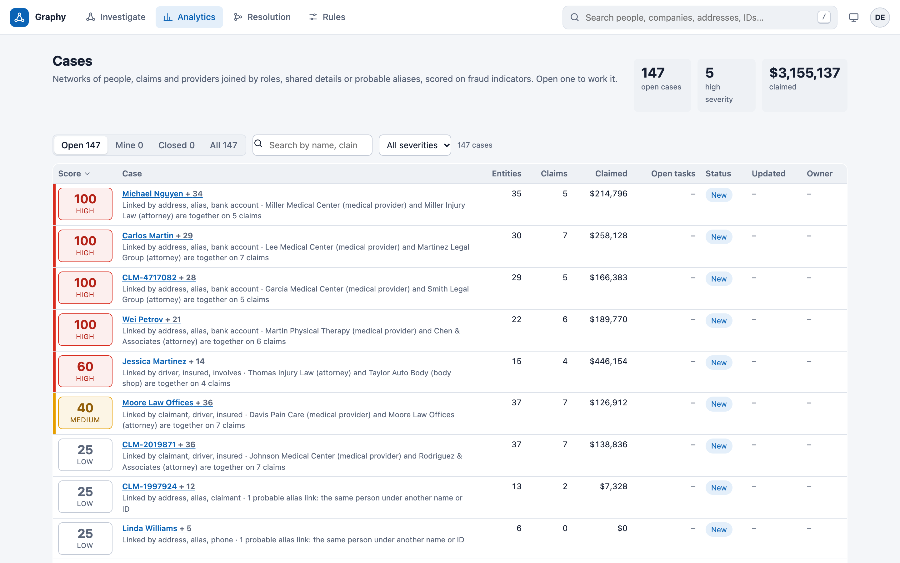
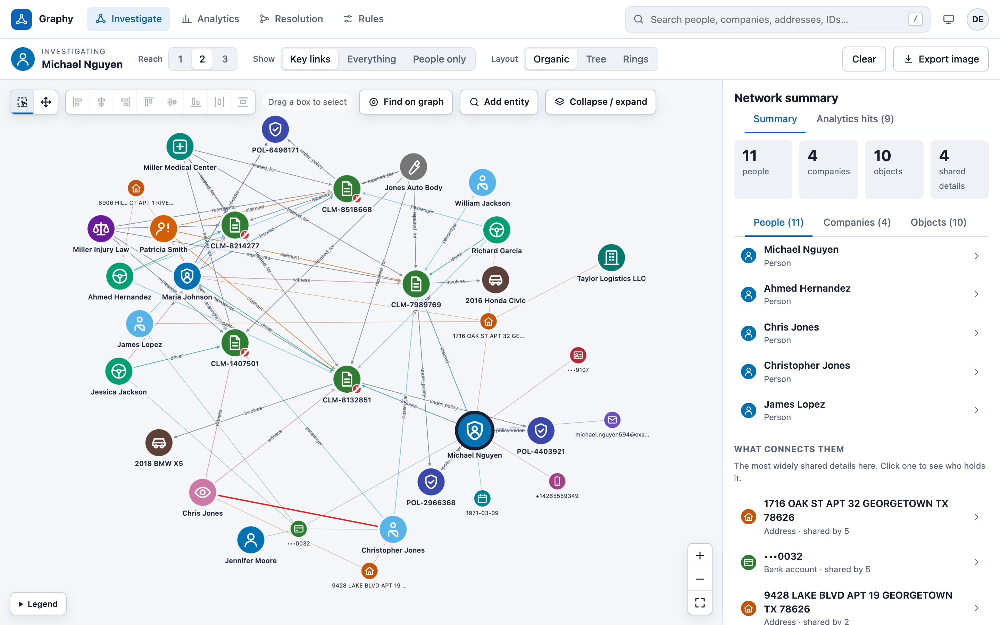
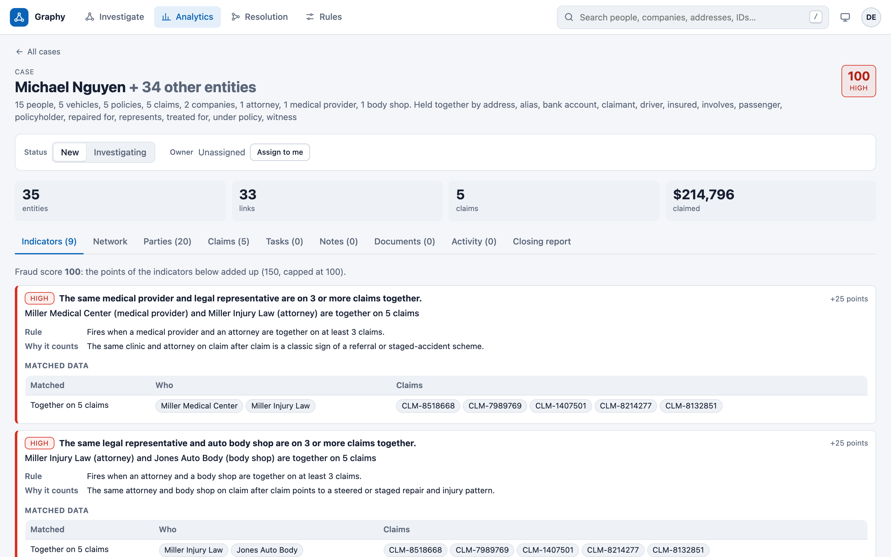
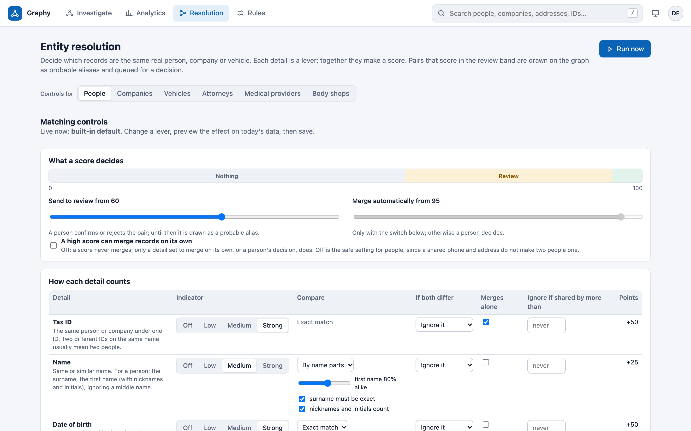

# Graphy

[](https://github.com/chuhorace92/graphy-fraud-network/actions/workflows/ci.yml)

Graphy finds hidden relationships between people, companies and providers in insurance claims
data, and flags the networks that look abnormal, such as one attorney, clinic and body shop
turning up on claim after claim. Investigators work each flagged network as a case.

It has four parts:

- **Entity resolution** decides which records are the same person, company or vehicle, with
  adjustable per-attribute scoring and a review queue for borderline pairs.
- **Network analytics** scores connected networks 0-100 against a library of editable fraud
  rules, and explains every indicator in plain language.
- **Network visualization** is an interactive investigation canvas with drill-down.
- **Case management** covers tasks, notes, documents, claims and a closing report, with an
  optional AI-drafted summary.

The stack is FastAPI, PostgreSQL and Neo4j on the back end, React and TypeScript on the front
end, with Docker Compose for local use and a Helm chart for Kubernetes. All demo data is
synthetic.



| | |
|---|---|
|  |  |
| **Investigate:** a network on the canvas, with the shared details that connect it | **Case indicators:** each rule, why it counts, and the data it matched |



*Resolution controls: how strongly each detail counts, how it is compared, and where review and
automatic merging start.*

## Run it

Requires Docker Desktop (or another Docker engine with Compose v2).

```sh
cp .env.example .env     # optional: override dev passwords
make up                  # builds images, starts everything, runs migrations
make seed                # loads ~400 synthetic people with planted rings, then resolves
```

| URL | What |
|---|---|
| http://localhost:8080 | Web app |
| http://localhost:8000/api/docs | API (OpenAPI / Swagger) |
| http://localhost:7474 | Neo4j browser (`neo4j` / `graphy-dev-password`) |

## Using the web app

Open http://localhost:8080. **Investigate** opens an empty workbench: search (press `/` from
anywhere) for a name, address, phone, email or full ID to put its network on the canvas, and use
**Add entity** on the canvas toolbar to bring in more. **Analytics** is the case queue: networks scored on
fraud indicators, which you work from a table and a case view.

- **Click** anything on the graph to see why it is there; the panel on the right explains it in
  plain language. **Double-click** a person to reveal who else they are connected to.
- Click a shared detail (a bank account, an address) to light up everyone who holds it.
- **Reach** sets how many links away to include. **Show** switches between key links,
  everything, or people only. The **Legend** button explains the icons.
- The Evidence tab shows why records were combined; History shows every value seen and when.
- **Resolution** is a control panel for how records are matched, one set of controls per kind of
  record (people, companies, vehicles, attorneys, medical providers, body shops). Each detail
  (SSN or tax ID, name, date of birth, email, phone, address, device, bank account, VIN, plate...)
  has levers: how strong an indicator it is (off, low, medium, strong), how it is compared (exact;
  fuzzy with a minimum similarity; **a person's name by its parts**, with the surname exact or
  close, the first name at least so alike, nicknames and initials counting and the middle name
  ignored; a date of birth by the exact day or just the year), what a difference does (ignore it,
  take off points, never merge), whether an exact match merges on its own, and when to ignore a
  value too many records share. The points add up to a score from 0 to 100; two sliders say where
  review and automatic merging start, a switch says whether a score can merge at all, and a
  safeguard keeps a pair with no identity match from ever merging. **Preview impact** shows what
  the settings would do to today's data before anything is saved; nothing changes until you
  publish. The defaults merge on a tax ID, an email or a VIN as before, and never on score alone
  for people.

For day-to-day development, run the databases in Docker and the code on the host:

```sh
make deps     # neo4j, postgres + migrations
make api      # FastAPI with reload on :8000   (needs uv)
make ui       # Vite dev server on :5173       (needs Node 20+)
make test
```

## Layout

```
backend/                 Python 3.12, FastAPI (uv-managed)
  graphy/catalog.py        attribute catalog: link strength, hub thresholds, sensitivity
  graphy/ingestion/        normalizers and the batch loader (idempotent MERGE into Neo4j)
  graphy/resolution/       record resolution (scoring.py: pair scoring; deterministic.py: merging,
                           the review queue, probable aliases, preview), SHARES and role links
  graphy/api/v1/           REST API, one module per area
  graphy/services/jobs.py  background jobs, run in the API process; every job writes a job_run row
  graphy/scripts/          init_db (migrations + graph schema), seed_demo (synthetic data)
  migrations/              Alembic (PostgreSQL: rule sets, overrides, jobs, audit)
frontend/                React 19 + TypeScript, Vite, TanStack Query, Zustand
  src/graph/GraphView.ts   renderer adapter; CytoscapeGraphView implements it
deploy/helm/graphy/      Kubernetes chart (api, web, migration hook)
.github/workflows/ci.yml lint, tests, integration run, Helm lint, image builds
```

One backend image serves both roles; the container command picks API or migrations. The web image is static files on unprivileged nginx, which proxies `/api`.

## Ingesting data

Ingestion accepts one canonical CSV layout, one attribute value per row:

```csv
source_key,entity_type,attr_type,value,first_seen,last_seen
C-1001,Person,name,Jane Doe,2021-03-01,2026-05-30
C-1001,Person,email,jane.doe@example.com,2021-03-01,2026-05-30
```

`attr_type` must be in the catalog (`tax_id`, `email`, `phone`, `address`, `device`,
`bank_acct`, `name`, `dob`, `incorporation_date`, plus the policy and vehicle details). Register a source, then upload a batch:

```sh
curl -X POST localhost:8000/api/v1/ingestion/sources -H 'content-type: application/json' \
  -d '{"name":"crm","source_system":"CRM"}'
curl -X POST localhost:8000/api/v1/ingestion/batches -F source=crm -F file=@extract.csv
```

The batch loads in the background of the API process, then triggers resolution. Rejected rows are
listed on the job (`counts.rejects`, first 1000) with the reason; rejects never include the value
itself. A job is lost if the API restarts while it runs, so submit the batch again.

### JSON ingestion

`POST /api/v1/ingestion/batches/json` takes the same data as JSON. An attribute is a value, a
list of values, or `{value, first_seen, last_seen}`; relationships name their records by
`source_key`. The response is a job id, polled at `/api/v1/jobs/{id}` like a CSV batch.

```sh
curl -X POST localhost:8000/api/v1/ingestion/batches/json -H 'content-type: application/json' -d '{
  "source": "crm",
  "records": [
    {"source_key": "C-1001", "entity_type": "Person", "first_seen": "2021-03-01",
     "attributes": {"name": "Jane Doe", "email": ["jane.doe@example.com"], "dob": "1980-02-29"}},
    {"source_key": "CLM-9", "entity_type": "Claim", "attributes": {"name": "CLM-9"}}
  ],
  "relationships": [{"from_key": "C-1001", "to_key": "CLM-9", "rel_type": "insured"}]
}'
```

The shape is checked on arrival (422 if wrong). Unknown attribute types, bad values and
relationships to missing records are rejected row by row into the job's `counts.rejects`.

### Insurance claims

The same pipeline carries claims, policies, vehicles, property and providers. `entity_type` can
also be `Claim`, `Policy`, `Vehicle`, `Property`, `LegalRep`, `MedicalProvider` or `BodyShop`
(`vin` is a new attribute; a shared VIN merges vehicle records). Who did what is a second CSV
layout, one relationship per row, loaded after the records it names:

```csv
from_key,to_key,rel_type,first_seen,last_seen
APP-000201,CLM-000310,witness,2026-03-02,2026-03-02
CLM-000310,POL-000305,under_policy,2026-03-02,2026-03-02
```

Allowed `rel_type` values and the entity types each may join are in `catalog.REL_TYPES`:
`insured`, `claimant`, `witness`, `driver`, `passenger`, `policyholder`, `owner`, `under_policy`,
`covers`, `involves`, `represents`, `treated_for`, `repaired_for`. Rows that name a missing
record or the wrong types are listed in the job's rejects.

After each resolution run the graph also gets:

- `RELATED_TO` edges between resolved entities, labelled with the role.
- `ALIAS_OF` edges (drawn red) between entities that look alike but did not merge: pairs of
  records that score in the review band of their type's rules (for people by default a name
  variant, such as Chris / Christopher or a middle name added or dropped, plus the same date of
  birth, higher when a phone, address, device or bank account is also shared). They come from the
  same scoring that merges, so the link and the **Needs review** entry are one pair: confirming
  it merges the records on the next run, rejecting it stops the question coming back. Nothing is
  merged without a person.
- `GET /api/v1/graph/networks`: connected networks scored 0-100 on fraud indicators, with the
  reasons, behind the Analytics page. The score comes from the published analytics rules
  (`GET /api/v1/analytics/rules`; defaults are stored by `init_db` and editable as new versions):
  two or more parties using one attribute; a medical provider and attorney together on 3+ claims;
  an attorney and body shop together on 3+ claims; and the same group of people on several auto
  claims with shifting roles. Aliases, repeat participants and claim timing add to the score.
- **Cases** (the Analytics page): every network of three or more entities is a case, ranked by
  fraud score and listed as a table; a row opens the case, which is worked from tabs: Indicators
  (each with the rule's test, why it counts, and the data it matched), Network (the graph in place,
  with the details panel, expandable to full screen), Parties (people, companies and providers;
  pick one for its record), Claims (loss and filing dates, type, amount, status, the SIU steps and
  who is on each), Tasks (pending / received / not received, edit, close; documents and notes can
  be attached to a task), Notes (a diary: entries on the left, the entry on the right; rich text,
  editable until the case is closed), Documents (each can be tagged to a task), Activity and the
  Closing report. A case ends as **Confirmed fraud**, **Not enough information** or
  **Dismissed**, only through the closing report, which also records whether the case was
  **Reported to an authority** (who, a reference, the date, and notes). A closed case can be
  reopened. `GET /api/v1/cases` is the queue, `GET /cases/{key}` one case, `.../claims` its claims;
  changes are `PATCH /cases/{key}`, `POST|PATCH|DELETE .../tasks` and `.../notes`,
  `POST|GET|PATCH|DELETE .../documents` (up to 10 MB each, kept in PostgreSQL, always served as a
  download), `PUT .../report` (draft) and `POST .../close`. Scores and indicators are computed live;
  what people do is stored in PostgreSQL the first time someone acts, and every change is audited.
  A case is keyed on its network's lowest entity id.
- **Notes** are HTML written in the browser editor. The server cleans them before they are stored
  (an allow-list of formatting tags; links only http, https or mailto; no scripts, styles or event
  handlers), and a closed case's notes cannot be changed until it is reopened.
- **Agent mode** (Closing report tab, `POST .../report/draft`): Claude reads the case facts, the
  notes and the documents and proposes an outcome, summary and recommendation. It saves nothing
  and never closes a case. **It is off** until `ANTHROPIC_API_KEY` is set (compose passes it as
  `GRAPHY_ANTHROPIC_API_KEY`; model `GRAPHY_AGENT_MODEL`, default `claude-opus-5-5`). What it reads is
  sent to the Anthropic API, and claim files hold personal and medical details, so turn it on only
  where that is acceptable.

- **Rules** page (`/rules`): the rule library. Edit a rule to save a new draft version, test it on
  today's data (`POST /analytics/rules/preview`), then publish it (`.../{id}/publish`, which also
  restores a retired version), retire it, or delete a draft. Publishing retires the previous live
  version; every change is audited. Only metrics the engine evaluates per network can be published.
  Every indicator a network shows is a rule here, so each can be tested, re-weighted or retired:
  the shared-attribute, provider-pair and recurring-group rules, and `repeat-participants` (a person
  on 3 or more claims), `probable-aliases`, `claims-bunched-in-time` (4 or more claims within 120
  days) and `claims-soon-after-policy-start` (2 or more within 60 days of the policy starting).
  A rule's points default to its severity's (5, 15 or 25) unless it sets its own, or scales
  with what it names ("points for each", up to a cap). Each finding carries the rule's test in
  words and the data it matched (shared values with who holds them, the claims two providers share,
  a group, a person's claims, an alias pair). The stack's start-up adds any default rule that is
  missing and never overwrites one you have edited.

Claims carry `loss_date`, `fnol_date` (first notice of loss), `loss_type` (tags: Property Damage,
Bodily Injury, or both), `loss_description`, `claim_status` and `claim_amount`. They describe the
claim and never link entities; the Inspector shows them as a claim summary.

`make seed` plants ordinary claims plus staged-accident rings: one attorney, clinic and body
shop across every claim, the same people rotating through the roles, and aliases of ring
members under new tax IDs and emails.

## Status

| Area | State |
|---|---|
| Ingestion, normalization, attribute versions | Working |
| Secret attributes stored only as keyed hashes, masked in the UI | Working |
| Resolution: per-attribute scoring, name parts, merge and review thresholds, aliases, overrides, known-different, size cap | Working |
| Preview impact: simulate a rule change on today's data before publishing | Working |
| Shared-detail links with hub detection | Working |
| Rule-set versioning: draft, publish, rollback | Working |
| Neighborhood, path, drill-down, search and explain APIs | Working |
| Investigation canvas, attribute panel, edge explanations | Working |
| Case management, rule library, closing report, optional AI drafting | Working |
| Append-only audit log, role checks, OIDC on the API | Working; sign-in from the UI is planned |
| Probabilistic matching with Splink (statistical match weights) | Planned; the scorer uses explicit, adjustable points |
| Community detection and outlier scoring runs | Planned; the endpoints return `501` |
| Household and company grouping above resolved entities | Planned; the canvas already nests groups |

Planned features already exist in the API contract and return `501` with the name of the missing
capability, so the front end can be built against the final shape.

Known gaps to close before production:

- Publishing a resolution run is not yet one atomic swap. Readers can briefly see both
  generations of entities (`graphy/resolution/deterministic.py`, `_publish`).
- Multi-attribute deterministic rules are skipped and reported in the job counts.
- The UI has no sign-in yet; it works against `GRAPHY_AUTH_MODE=dev`, which the backend
  refuses to start with in staging or production.
- The graph renderer is Cytoscape. The UI only talks to the `GraphView` interface, so another
  renderer (yFiles, for example) can replace `CytoscapeGraphView` without touching the pages.

## Deploying

```sh
helm upgrade --install graphy deploy/helm/graphy -n graphy \
  --set image.backend.tag=<sha> --set image.web.tag=<sha> \
  --set config.OIDC_ISSUER=... --set ingress.host=graphy.example.com
```

Secrets come from the Secret named by `existingSecret` (sync it from your secrets manager);
the keys it must hold are listed in `values.yaml`. Migrations run as a pre-install and
pre-upgrade hook. Neo4j (a three-node cluster in production)
and PostgreSQL are external.

## License

MIT, see [LICENSE](LICENSE). All data in the demo is synthetic.
